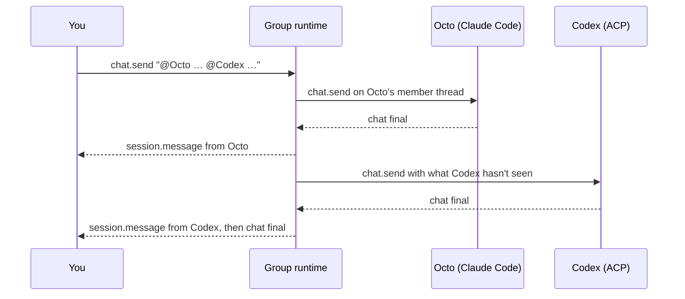

# Group chats across agents

**Status:** proposal, nothing built yet. The decisions that need herval are at the end.

A group is a contact that holds several little guys of any kind. You write once. The guys you @mention answer, one at a time, and they can hand work to each other the same way:

> **You:** @Octo the invoice export is failing, can you look? @Codex review whatever Octo changes.
> **Octo:** The total was rounding twice. Fixed in `export.ts`. @Codex over to you.
> **Codex:** Looks right, but the same rounding is in `tax.ts`. @Octo want to fix that too?
> **Octo:** Done.

Octo can be Claude Code on this Mac, Codex an ACP agent, and a third member an OpenClaw agent on a home server. Nothing else does that today, and it's the most WhatsApp-like feature littleguys doesn't have.

## Why

- hermes-webui's most-upvoted open issue ([#7174](https://github.com/nesquena/hermes-webui/issues/7174), 21 👍) asks for a roster of agents with @mention handoffs.
- [Hermes Bot Mode](https://hermes-agent.nousresearch.com/docs/user-guide/bot-mode) ships this in Hermes Desktop, for Hermes profiles only.
- [Aight](https://aight.cool/) has group chats, in a closed-source phone app.
- People asked hermes-agent for this too: [#514](https://github.com/NousResearch/hermes-agent/issues/514) (53 👍, agent-to-agent) and [#5257](https://github.com/NousResearch/hermes-agent/issues/5257) (27 👍, an ACP client for many agents).
- Google autocomplete has "claude code sessions talk to each other" and "claude code sessions message each other".

littleguys already talks to every kind of agent through one surface, so it can do this across kinds. It's also easy to show in a short video.

## What it isn't

Keep it small. Not in this feature:

- No planner, no boss agent, no task board.
- No shared memory or knowledge base. A group's history is the only thing members share.
- No agent-to-agent protocol, and nothing installed into the agents. A member only ever gets a normal message.
- No direct messages between members outside the group.
- No templates or preset teams.

## How it looks

- **Making one:** **New group** in the sidebar. Pick 2 to 6 guys, a name and an emoji, and a folder if any member works in folders. The sheet says once: "Everyone in a group reads everything said in it."
- **In the list:** a group is a card among the guys, sorted by recency, with an overlapping stack of its members' faces. It's in the popover too, with quick reply.
- **In the thread:** one thread per group, forever, as in WhatsApp. Replies show the member's face and name. A member's tool calls stay out of the group: a reply has a quiet **See what Octo did** link that opens that member's own thread.
- **Composer:** typing `@` opens a member menu, reusing the slash menu.
- **While it runs:** a typing row says who's working ("Octo is working"). The Stop button ends the member's run and the rest of the round.
- **Needs you:** an approval from a member shows in the group as a normal card, labelled with who's asking.
- **Notifications:** one when the group settles, not one per reply.

## Who speaks when

The rules, in order:

1. **@mentioned members answer**, in the order they were mentioned.
2. **With no mention,** the last member who spoke answers. In a new group, everyone does. (Decision 1.)
3. **One at a time.** Turns are serial, so two agents never edit the same folder at once.
4. **A reply can @mention other members.** They go next. That's the only way a member gets another turn.
5. **A member with nothing to add replies `PASS`.** That reply isn't shown.
6. **It stops** when nobody's been mentioned, or at the limits.

| Limit | Value | Why |
|---|---|---|
| Members | 2 to 6 | Same as Hermes |
| Rounds per message of yours | 3 | Same as Hermes |
| Replies per message of yours | 10 | Same as Hermes |
| Time for one turn | 10 minutes, paused while an approval waits | Same as Hermes' relayed turn |
| History in one turn | 32,000 characters; one message at most 8,000 | Same as Hermes. Earlier ones are dropped, and the prompt says how many |

At a limit, the thread shows one line ("Stopped after 10 replies") and waits for you. A message you send while a group is running waits until the round ends. Stop drops anything still queued.

## Design: a group is a runtime

Every adapter already speaks the same OpenClaw-shaped calls and events (`runtime/mod.rs`), and everything above them doesn't care what's behind a guy. So a group is one more adapter, `runtime/group.rs`, with `RuntimeKind::Group`:

- **Each group is an agent** in `agents.list`, so it's a guy with a `agent:<groupId>:main` thread. `hasMainChat` is already true for any kind other than ACP and Claude Code.
- **The sidebar, popover, unread state and notifications work** from `sessions.list`, `chat` and `session.message`, with little change.
- **Paired phones get groups for free:** the bridge passes every gateway through, so a phone can chat in a group with no new protocol. Making groups stays on the desktop at first.
- **It runs in Rust,** so a group keeps going with the window closed, and a reply from a phone starts it the same way.



### Pieces

- **`GroupClient`** holds a `Weak<Hub>`, and reaches members through `Hub::client(gatewayId)`, then `Runtime::call`.
- **The event tap.** `Hub::spawn`'s event hook also passes each event to `GroupClient::on_member_event(gateway, name, payload)`. It only acts on member threads it owns.
- **Saved entry.** One `GatewayEntry` of kind `Group`, added when the first group is made and kept out of Settings → Connections.
- **Storage** stays in littleguys' data dir, never in the agents' files: `groups/<id>.json` for the name, emoji, members, folder and member threads, and `groups/<id>.jsonl` for the transcript.

```json
{
  "id": "g-launch",
  "name": "Launch",
  "emoji": "🚀",
  "folder": "/Users/you/dev/billing-api",
  "members": [
    { "gatewayId": "claude", "agentId": "claude", "handle": "octo", "thread": "agent:claude:dashboard:a1", "seen": 41 },
    { "gatewayId": "acp-codex", "agentId": "codex", "handle": "codex", "thread": "agent:codex:dashboard:b2", "seen": 38 }
  ]
}
```

`seen` is the last group message that member has been given. A handle is the guy's name, lowercased. With two guys of the same name, the second gets its gateway too (`fox-studio`).

### Calls

| Call | What the group does |
|---|---|
| `agents.list` | One agent per group |
| `agents.create`, `agents.update`, `agents.delete` | Make, edit and remove groups, with `members` and `folder` as extra params |
| `sessions.list` | One row per group |
| `chat.history` | Reads the `.jsonl` |
| `chat.send` | Appends your message and starts the turn engine |
| `chat.abort` | Sends `chat.abort` to the member who's running, and clears the queue |
| `exec.approval.list`, `exec.approval.resolve` | Passes through to the member's runtime |

Capabilities: `approvals`, `attachments` and `manage_guys` on, the rest off.

### Turn engine

```text
on your message M:
  speakers = mentioned(M) or default_speakers()
  rounds = replies = 0
  while speakers and rounds < 3 and replies < 10:
    next = []
    for member in speakers:
      text = turn(member)         # prompt, chat.send, wait for chat final
      if text is empty or PASS: continue
      append to the group; replies += 1
      next += members mentioned in text, except member
      if replies == 10: break
    speakers = next, without duplicates
    rounds += 1
  emit chat final on the group's thread
```

`turn` waits for the member thread's `chat` event with state `final`, `aborted` or `error`. All the adapters emit these. The reply is the member's last assistant text. The group re-emits `chat` status and any deltas on its own key, labelled with the member, so the typing row and streaming work.

Mentions are matched against handles, longest first, ignoring case, and never inside code or quotes.

### What a member gets

Each member has one ordinary thread of its own, made with `sessions.create` the first time it speaks, in the group's folder. Its message is:

```text
[littleguys group "Launch": you're Octo. Also here: Codex and the person.]

Since your last turn:
The person: @Octo the invoice export is failing, can you look?

Answer the group briefly. @mention a member only to hand them work.
If you have nothing to add, reply exactly: PASS
```

Only what the member hasn't seen goes in, because its own session holds the rest. That keeps turns cheap, and each agent keeps its own memory, tools and permissions. `transcript.ts` recognises the first line, so the member's own thread shows this as a note, not a wall of text.

### Author on a message

`ChatMessage.senderLabel` exists, but `transcript.ts` only reads it for user messages. A group's reply is an assistant message with `senderLabel` and a new `senderGuy`, `{gatewayId, agentId}`, for the face. Older phones ignore unknown fields, so they'd show replies with no name until the iPhone app catches up.

### Approvals

A member's `exec.approval.requested` on a member thread is re-emitted by the group on the group's key, with the member's name in the text. Resolving it from either place resolves it in the member's runtime. `Activity` notifies once: approvals on member threads don't notify on their own. A group never approves anything by itself, and "Always allow" stays with that member.

A waiting approval holds the group, since turns are serial, and pauses the turn timeout.

### When things go wrong

| Case | What happens |
|---|---|
| A member fails or times out | One line in the thread ("Octo couldn't answer: …"), and the round goes on |
| A member's gateway is offline | Same line, skipped this round. It gets what it missed next time |
| A member is removed, or its guy is deleted | It leaves the group. Below 2 members the group is read-only |
| The app quits mid-round | On launch the round is over, with one line saying so. Nothing restarts by itself |
| A member thread is deleted or archived | A new one is made next turn, with the last 32,000 characters of the group |

### Privacy and safety

- Everything said in a group goes to every member, so to each member's model provider. The create sheet says so.
- A member's text is untrusted input to the others. An agent can't get anything from a group that it couldn't get from you pasting that text in. Approvals still gate every risky action, and the limits bound any loop.
- It's still no telemetry and no account. Nothing goes through a littleguys server.

## By adapter

| Runtime | Member thread | Folder | Notes |
|---|---|---|---|
| OpenClaw | `sessions.create` | The agent's workspace | Doesn't share the group's folder. Files need a path it can reach |
| Hermes | `sessions.create` | The profile's | Same |
| ACP | `sessions.create` | The group's folder | One session per group |
| Claude Code | A draft, then `claude --bg` in the group's folder | The group's folder | Background, so its prompts come to littleguys |
| Codex | Whichever adapter it's on | The group's folder | See the Codex sessions PR |

To check in the first milestone: `sessions.create` with a label on each adapter, and how a group's folder reaches each one (`chat.send` already takes `cwd`).

## Milestones

1. **Engine, no UI:** `group.rs`, storage, turn engine, and tests with scripted members. Try it with Claude Code and one ACP agent through a small test harness.
2. **Desktop:** the create sheet, author on replies, the @ menu, the typing row, Stop, See what Octo did, and limit lines.
3. **Approvals and notifications.** Ship from here, not before: without approvals, a group stalls on its first command.
4. **iPhone:** names and faces on replies, in `littleguys-ios`.
5. **Later, if people ask:** images between members, parallel turns for members with no folder, `@all`, a lead member.

## Testing

- The engine takes members through a small trait, so tests script replies, failures, timeouts and mention loops without an agent.
- Must pass: two members who keep @mentioning each other stop at 3 rounds; `PASS` shows nothing; Stop mid-turn clears the queue; a quit mid-round doesn't resume; an approval pauses the timeout.
- By hand, before shipping: one group with Claude Code, an ACP agent and an OpenClaw gateway, from the desktop and a phone.
- Mocks use fictional guys.

## Decisions for herval

1. **With no @mention, who answers?** Recommended: the last member who spoke, and everyone in a new group. It's how talking in a group works, and "thanks!" doesn't cost six agent turns. The alternative is everyone every time, with `PASS`, as Hermes does.
2. **Do member threads show in each guy's own thread list?** Recommended: yes, labelled with the group's name and never unread. They're real sessions, and it's how you see what a member did. The alternative is hiding them behind See what Octo did.
3. **One folder for the group, or one per member?** Recommended: one. Serial turns make it safe, and it's one field. Per-member folders would let two coding agents work on separate worktrees, but that's the workspace app littleguys isn't.
4. **Do groups mix with guys in the list?** Recommended: yes, as in WhatsApp. The alternative is a section of their own.
